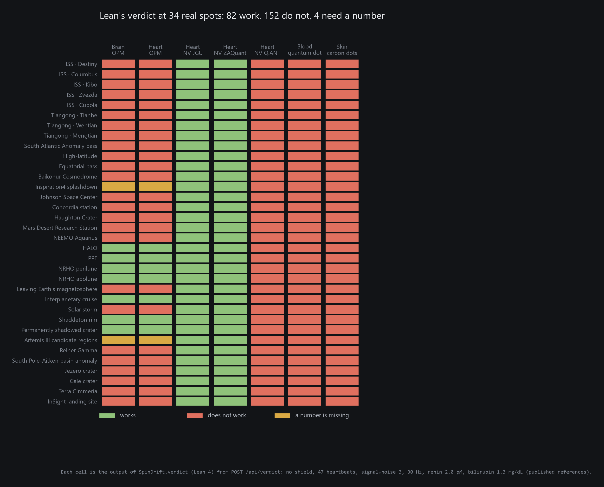
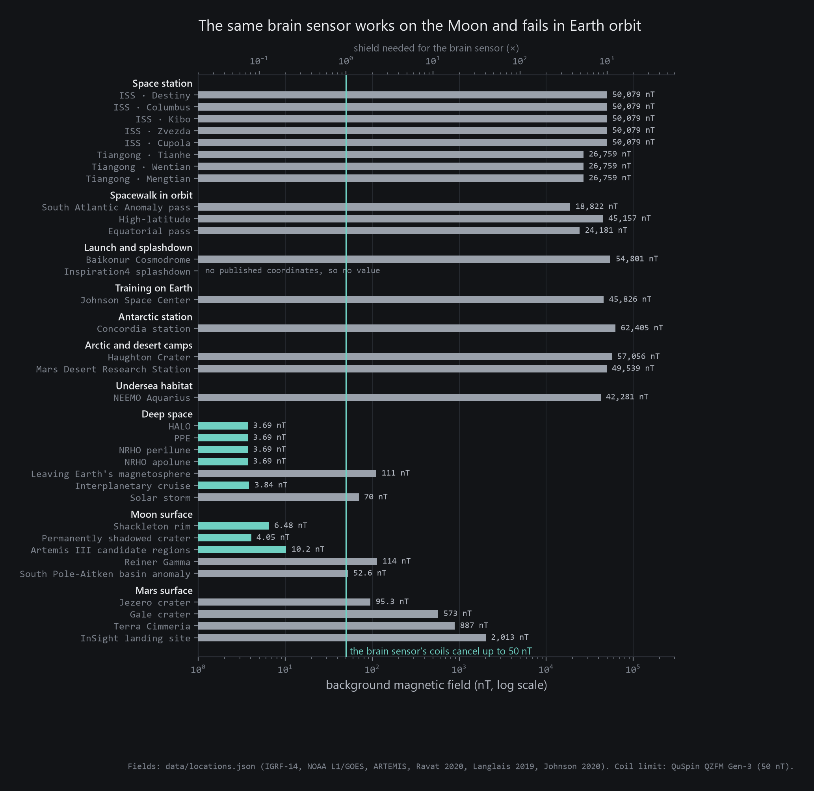
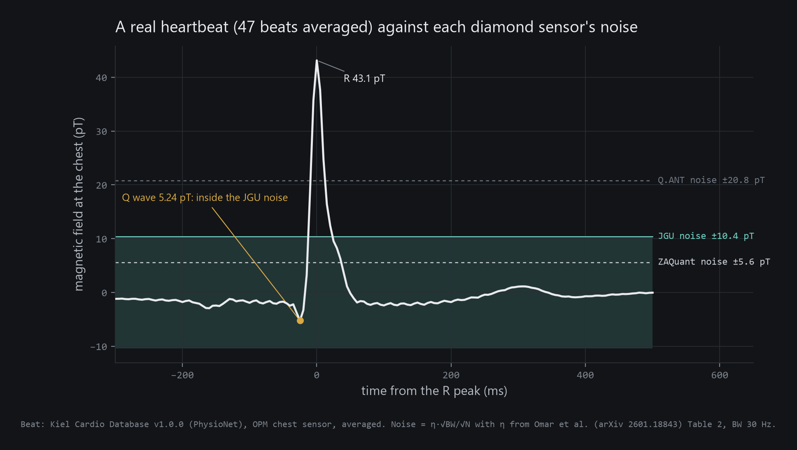
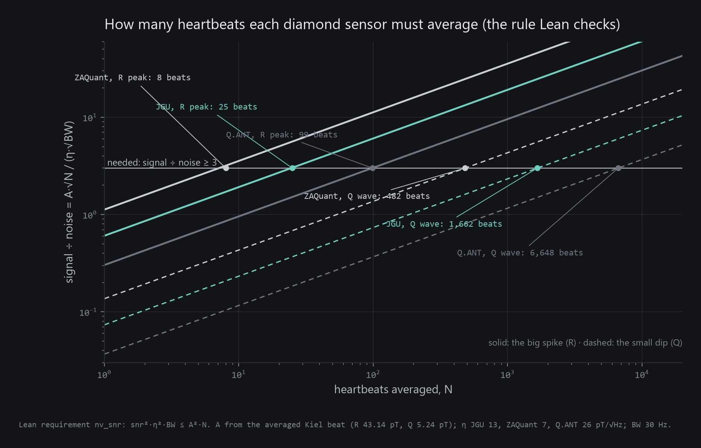
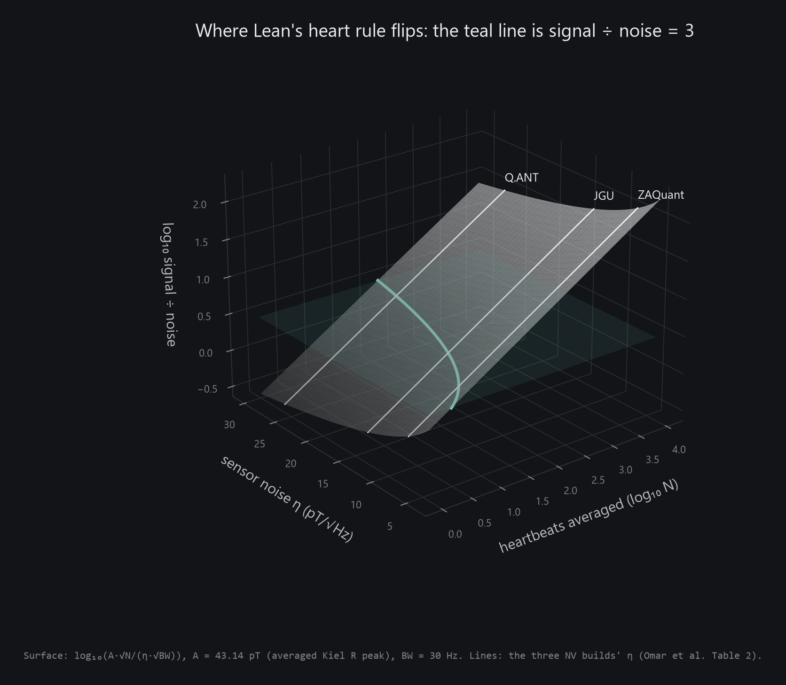
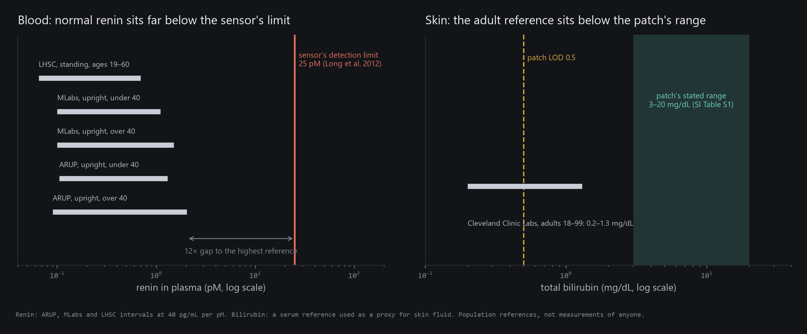
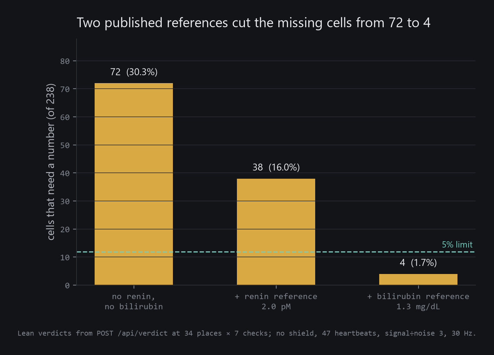

# SpinDrift


**Quantum sensors for astronauts, with a proof checker as the referee.**

SpinDrift asks one question about four quantum sensors: does each one work at a real place in space, and under which conditions? Lean 4 makes the decision from sourced numbers. A missing number never decides; it is shown as missing.

**Public site:** not live yet. It is set to deploy from `main` to Vercel as `spindrift-v10`; see [Public site](#public-site).

## The four sensors

| Job | Sensor | Quantum part | What Lean checks |
|---|---|---|---|
| Brain field | Optically pumped magnetometer (QuSpin QZFM Gen-3) | Rb-87 atoms, 795 nm light (D1 line) | The shield must bring the ambient field inside the sensor's ±50 nT nulling range (`opm_brain`, `opm_heart`) |
| Heart field | NV diamond, JGU, ZAQuant and Q.ANT builds | NV⁻ spins in diamond, read by microwave resonance | The signal-to-noise, with the heartbeats averaged, must reach the required level (`nv_heart_jgu`, `nv_heart_zaquant`, `nv_heart_qant`) |
| Blood renin | Single quantum-dot FRET nanosensor (Long et al. 2012) | Quantum-dot donor, Cy5 acceptor, single-molecule counting | Renin must be at or above the 25 pM detection limit (`qd_blood`) |
| Skin bilirubin | Carbon-dot dermal nanotattoo (Tabatabaee et al. 2024) | Carbon quantum dots; fluorescence recovers under blue light | Bilirubin must sit inside the patch's stated range (`cqd_skin`) |

## How Lean decides

- Each check returns one verdict: **works** (`REQUIREMENTS_MET`), **does not work** (`NOT_MET`) or **needs a number** (`NEED_MORE_INFORMATION`).
- The checker is in `lean/`: Lean 4.35, core library only, 50 theorems, no unproven steps.
- Python only builds the inputs and calls the checker (`spindrift-check`). Python never decides a verdict.

## What we learned



1. **Brain (OPM).** With no shield it works at 7 of 34 places: HALO, PPE, the NRHO perilune and apolune, interplanetary cruise, Shackleton rim and a permanently shadowed crater. It does not work at 25. The strictest shield the stored runs needed is × 1,248, at Concordia station.

   

2. **Heart (NV diamond).** With the R peak and 47 heartbeats averaged, the JGU and ZAQuant builds work at all 34 places. The Q.ANT build works at none; in the stored runs it needed up to 273 heartbeats.

   
   
   

3. **Blood (quantum dot).** It does not work at normal renin levels. Its detection limit, 25 pM, is about 12 times the highest published reference (about 2.0 pM).
4. **Skin (carbon dots).** It does not work at normal adult bilirubin levels. Its stated range starts at 3 mg/dL, and the adult reference tops out at 1.3 mg/dL.

   

5. **Missing numbers.** Two published references and the patch's own range took the cells that need a number from 72 to 4 (30.3% to 1.7%), under the 5% limit. The 4 left are the brain checks at the Inspiration 4 splashdown and the Artemis III candidate regions, where no source gives the field inside the module.

   

The figures are drawn by `slides/make_figures.py` from the data files and the running Lean checker (`LEAN_API=http://127.0.0.1:8001 python slides/make_figures.py`).

## Where the numbers stand

The verdict matrix has 34 real places × 7 checks = 238 cells. It runs with fixed inputs: no shield (×1), 47 heartbeats averaged, signal-to-noise 3, 30 Hz.

| Inputs | Works | Does not work | Needs a number |
|---|---|---|---|
| No renin, no bilirubin (the first deck) | 82 | 84 | 72 (30.3%) |
| Plus renin = 2.0 pM (published reference) | 82 | 118 | 38 (16.0%) |
| Plus bilirubin = 1.3 mg/dL (published adult reference) | 82 | 152 | 4 (1.7%) |

Target: at most 5% missing, which is 11 of 238. We are at 1.7%.

- **Blood, decided: does not work at all 34 places.** The detection limit is 25 pM. The highest published renin upper limit we found is 81.6 pg/mL, about 2.0 pM, roughly 12 times below the limit.
- **Skin, decided: does not work at all 34 places.** The patch's stated range is 3–20 mg/dL, with a detection limit of 0.5 mg/dL. Both come from Table S1 of the paper's Supporting Information, page S10 (row "Our sensor"). The highest adult total bilirubin upper limit from a laboratory we found is 1.3 mg/dL. The paper measures bilirubin in interstitial fluid and reports high correlation with blood bilirubin; using the serum reference is a proxy, and an assumption.
- **Brain, 4 cells still missing.** At two places, the Inspiration 4 splashdown and the Artemis III south-pole regions, the magnetic field inside the spacecraft module is not in any source we hold. Both OPM checks there stay undecided.

A value enters only with a source. Reference values are population intervals, not measurements of anyone, and each is labelled as one.

### Where the references come from

- **Renin, upper limit:** ARUP's direct renin interval, upright, age over 40, 3.6–81.6 pg/mL (https://ltd.aruplab.com/api/ltd/hotline/2001575/1). Other laboratories are lower: MLabs, 4–44 pg/mL under 40 and 4–60 over 40 (https://mlabs.umich.edu/tests/renin-plasma-mass); LHSC, 2.6–27.7 ng/L (https://www.lhsc.on.ca/media/10385/download).
- **Renin, conversion:** 1 pM ≈ 40 pg/mL, for renin at about 40 kDa. Cayman Chemical lists the mature enzyme at 40 kDa (https://www.caymanchem.com/product/10006217/renin-human-recombinant); the calculated mass is 37–38 kDa, and glycosylation adds 4–7 kDa. At 37–44 kDa the value is 1.9–2.2 pM. This conversion is our calculation.
- **Bilirubin, adult upper limit:** Cleveland Clinic Laboratories, total bilirubin 0.2–1.3 mg/dL for ages 18–99 (https://clevelandcliniclabs.com/test/bilirubin-total/).
- **Carbon-dot patch range and detection limit:** Tabatabaee et al., Supporting Information, Table S1, page S10 (https://doi.org/10.1021/acsnano.4c06191; figshare 27153931, file `nn4c06191_si_001.pdf`).

## Public site

The site is set to deploy from `main` on Vercel as `spindrift-v10`. The Vercel project does not exist yet, so the URL is not live. Once it is created and deployed, its public address will be listed here.

## Hardware

- **Brain bench, 795 nm.** `hardware/beamteam/opm_795_bench.json` is a [BEAMTEAM](https://github.com/elevenarms/beamteam) design of a Rb-87 D1 bench: circular light through a 3 mm Rb vapour cell, then a polarizing beamsplitter onto two balanced photodiodes. BEAMTEAM's offline tracer and verifier pass it: 10 mW in, 5.0 mW on each photodiode, no stray light, no warnings. The design is not a built device. The tracer does not model Faraday rotation or the magnetic signal. Report: `hardware/beamteam/opm_795_bench_report.txt`.
- **Electronics, from the PCB Brew catalogue.** An ESP32-S3-DevKitC-1 with one ADS1115 passes the wiring check. Two ADS1115 on one I²C bus fail: both default to address 0x48, and the catalogue part has no address pin. At peak the board draws 500 mA, the USB limit, so the design needs an external 5 V supply.
- **BEAMTEAM** is MIT-licensed; this repo uses commit `7b7aafd` of its `main` branch. Its own tracer tests pass 43 of 43 in an isolated environment.

## Run it locally

```bash
pip install -r requirements.txt
python scripts/build_lean.py
python -m uvicorn server.main:app --host 127.0.0.1 --port 8001
```

Open http://127.0.0.1:8001/ui/. With the server running, recount the matrix with `python scripts/lean_matrix_check.py --renin 2.0 --bilirubin 1.3`.

Run BEAMTEAM's bench check with `BEAMTEAM_BACKEND=/path/to/beamteam/backend python hardware/beamteam/run_beamteam.py hardware/beamteam/opm_795_bench.json`.

## Repository

- `server/`: the FastAPI app. `verdict.py` builds the Lean inputs; `summary.py` summarises the runs.
- `lean/`: the Lean 4 proofs and the checker.
- `ui/`: the web app: the astronaut, the Lean cards, the Hardware and Unified sensor tabs.
- `data/`: sourced data. Each value carries its source, tag and status. `data/literature/` holds the values taken from each device's own paper.
- `api/`, `scripts/`, `vercel.json`: the Vercel build and API.
- `hardware/beamteam/`: the bench design, its report and the runner.

## Sources

The app's Sources panel lists the references, and each data value names its own source.

- Zhao, Mammei & Fujimoto, arXiv:2408.02941 (QZFM magnetometer).
- Omar et al., arXiv:2601.18843 (NV builds; sensitivities 13, 7 and 26 pT/√Hz in Table 2).
- Long et al., Anal. Chem. 84, 8846 (2012), doi:10.1021/ac302284s (renin nanosensor, 25 pM detection limit).
- Tabatabaee et al., ACS Nano 18, 28012 (2024), doi:10.1021/acsnano.4c06191 (carbon-dot patch; range and detection limit from its Supporting Information, Table S1).
- Barry et al., Rev. Mod. Phys. 92, 015004 (2020) (NV physics).
- NASA OSDR Inspiration4: openly released processed data. No crew member is identified.

## Limits

- Not diagnostic. Nothing here says whether a person has a condition, and nothing here is medical advice.
- The designs are designs, not built or tested devices.
- No live feed from these sensors on a human in space exists. The app says which of its feeds are live, near-live or recorded.
- Two of the blood and skin inputs are population reference values, labelled as such, not measurements.
